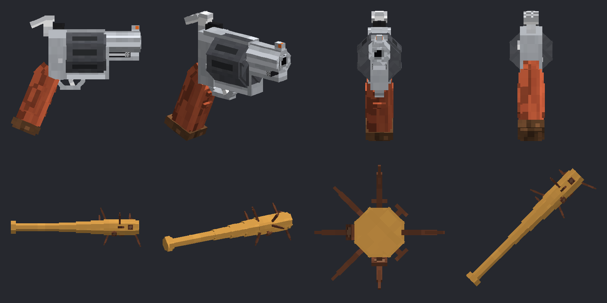

# HandCannon (Paper 26.2, Java 25)

A comically oversized snubnose revolver (right-click to fire, no ammo, no reloading) and a nail-studded
baseball bat (a fully charged swing is a home run), both with 3D models.

## Build
No JDK 25 handy? Push this folder to a GitHub repo: `.github/workflows/build.yml` builds the jar and the resource pack
and attaches both to the run (Actions tab, artifacts `HandCannon-jar` and `HandCannon-resourcepack`).
    gradle build            # needs JDK 25; jar ends up in build/libs/
Drop the jar in `plugins/`.

## Resource pack
    python3 tools/make_pack.py handcannon-resourcepack   # needs Pillow; writes handcannon-resourcepack.zip, prints its sha1, writes preview.png
Host the zip at a public URL, then set `resource-pack.url` and `resource-pack.sha1` in `plugins/HandCannon/config.yml`
and run `/hc reload`. Players are asked to accept it on join (`/hc pack [player]` resends it).
Without the pack the gun shows as a missing-texture block.
Set `FINISH` at the top of the textures section to `stainless` (bright frame, dark cylinder), `blued` or `black`.

The model is built from boxes in `tools/make_pack.py` (barrel points north, grip at the back). How it sits in first
person, third person, the inventory and item frames is the `DISPLAY` table near the bottom of the geometry section:
change a rotation, nudge or scale, re-run the script and re-host the zip.

## Commands
    /hc give [gun|bat] [player]   give a Hand Cannon (default) or a Nail Bat (op)
    /hc reload              reload config.yml (op)
    /hc pack [player]       resend the resource pack (op)
Permission `handcannon.use` (everyone by default) is needed to fire.

## Shooting
Right-click (air, blocks or point-blank on a mob) fires a hitscan shot: big muzzle blast, smoke trail, block chips or
crits where it lands. Hits do `damage` (x `headshot-multiplier` at head height) and shove the target; the shooter gets
pushed back and their view kicks up. The cooldown shows as the sweep on the item. All of it is in `config.yml`.

## Nail Bat
A heavy, slow melee weapon: 9 damage at full strength, a bit under one swing a second. Wait for the attack
indicator to fill before swinging and the hit is a home run: a crack, a burst of crits, "HOME RUN!" on your
action bar, and the target goes flying with a cloud trail. Damage and speed are stamped on each bat when it is
given (`bat.damage`, `bat.attack-speed`); the home-run settings apply right away. The bat is a stick underneath,
so it is kept out of crafting grids and furnaces.
